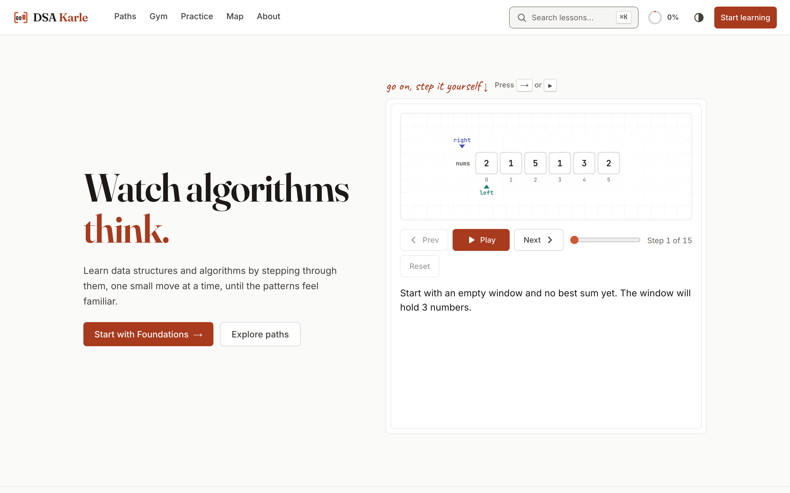
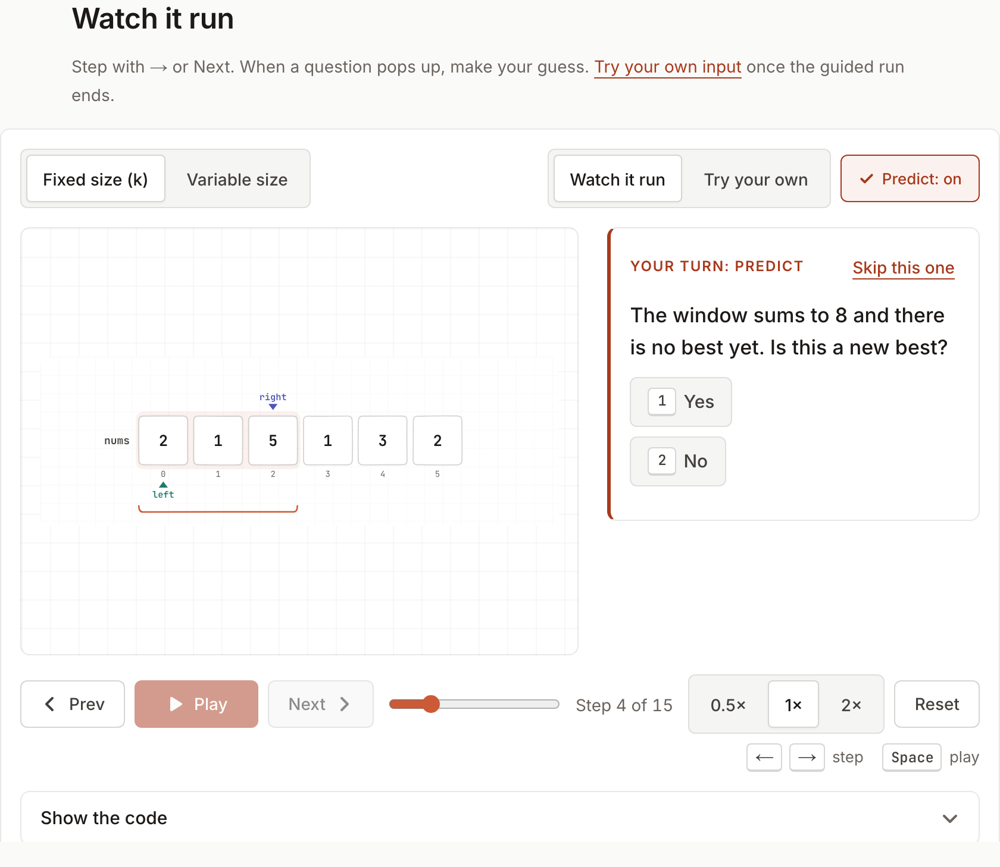
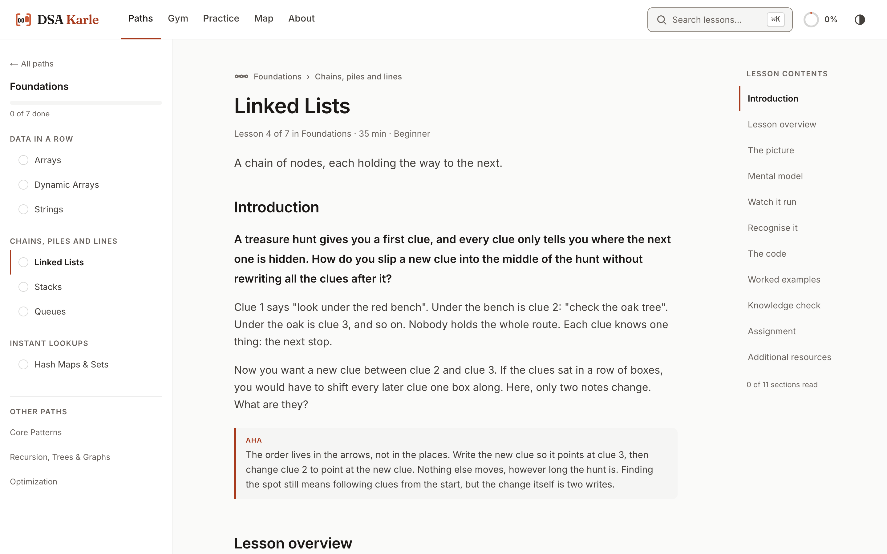
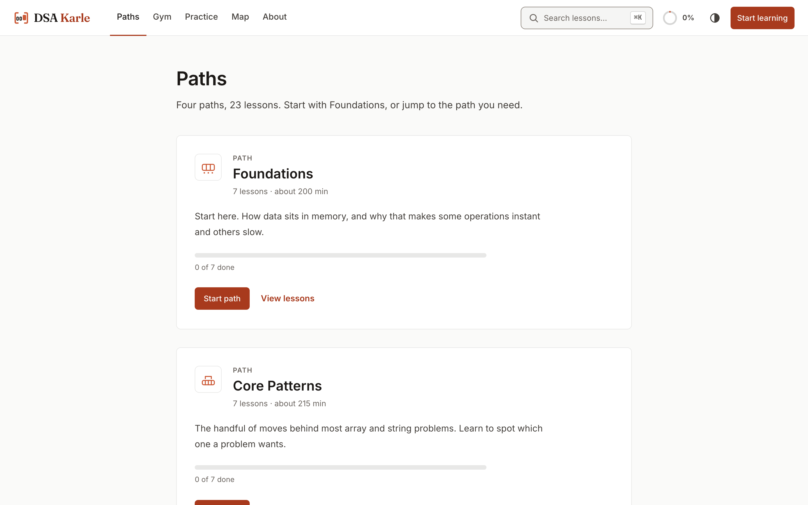
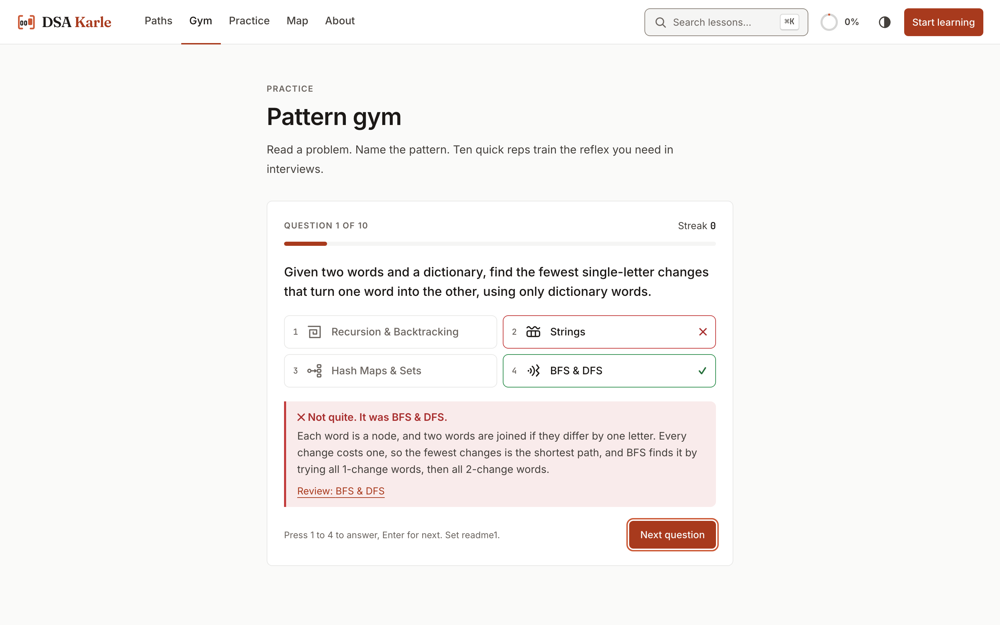
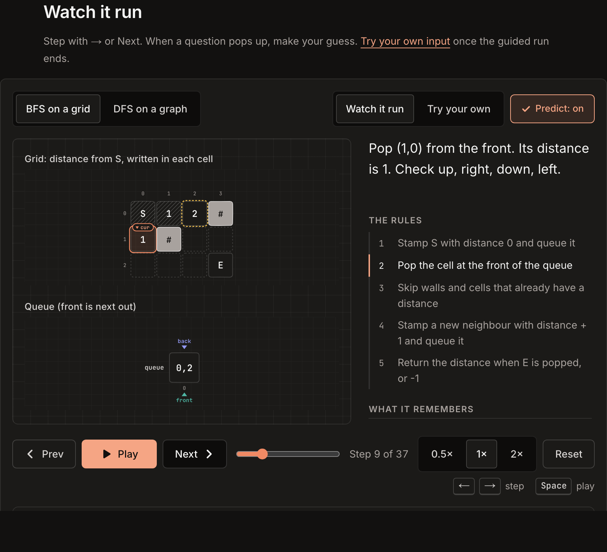
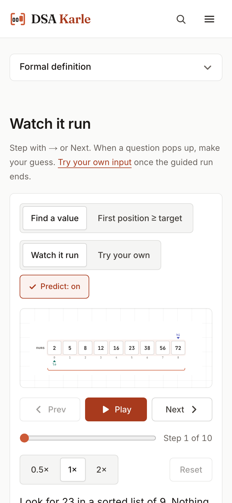

# DSA Karle

**Learn data structures and algorithms by watching them run.**

DSA Karle teaches each idea in the same order. You see a picture of it, step through the real algorithm, guess its next move, try your own input, and only then read the code in Python, Java or C++.

*Karle* is Hindi for "do it". The site is built around doing, not just reading.

**Live site:** https://dsakarle.vercel.app



---

## A look inside

**Predict, then watch.** The walkthrough stops at decisions and asks for your guess.



| | |
|---|---|
|  |  |
| **Lessons** read like a calm course page: path contents on the left, lesson contents on the right. | **Paths** group the 23 lessons into four tracks with progress. |
|  |  |
| **Pattern Gym** trains the "which pattern is this?" reflex. | **Dark mode**, here with BFS spreading across a grid. |

<p align="center"></p>
<p align="center"><em>Works on phones too.</em></p>

---

## What you can do

- **Follow a path.** 23 lessons are grouped into four paths, each split into short sections. Start at Foundations, or jump to the path you need.
- **Watch it run.** Every lesson has an interactive walkthrough driven by the real algorithm, not hand-drawn slides. Step with `←` / `→`, play, pause and scrub, and see the matching line light up in each language.
- **Predict the next move.** The walkthrough pauses at key decisions ("Expand or shrink?", "Which pointer moves?") and asks for your guess before it shows you.
- **Try your own input.** Type your own array, string, grid or graph and watch the same algorithm run on it.
- **Open the visualizer.** The `/visualize` page lists every algorithm on the site (65 of them) as a standalone playground. Search it, filter by path, or press **Surprise me**.
- **Recognise the pattern.** Each lesson ends with "reach for it when / not this when" clues and recognition questions. The **Pattern Gym** mixes them across all lessons, and questions you missed come back more often.
- **Practise for real.** Each lesson has worked examples and an assignment of LeetCode problems. The Practice page collects all of them, and every link points to a real, free problem.
- **Track progress.** Mark lessons complete, see per-path progress on the dashboard, and pick up where you left off. Progress is stored in your own browser; there are no accounts.
- **Find your way.** Search everything with `⌘K` / `Ctrl+K` or `/`, browse the pattern map of how the ideas connect, and switch between light and dark mode.

## Paths and lessons

| Path | Sections and lessons |
|---|---|
| **Foundations** | **Data in a row:** Arrays, Dynamic Arrays, Strings<br>**Chains, piles and lines:** Linked Lists, Stacks, Queues<br>**Instant lookups:** Hash Maps & Sets |
| **Core Patterns** | **Pointers and windows:** Two Pointers, Sliding Window, Fast & Slow Pointers, Prefix Sum<br>**Searching and sorting:** Binary Search, Searching, Sorting |
| **Recursion, Trees & Graphs** | **Thinking recursively:** Recursion & Backtracking<br>**Trees:** Binary Trees, Binary Search Trees, Heaps & Priority Queues, Tries<br>**Graphs:** Graphs, BFS & DFS |
| **Optimization** | **Choosing well:** Greedy<br>**Remembering answers:** Dynamic Programming |

Every lesson has the same sections:

**Introduction → Lesson overview → The picture → Mental model → Watch it run → Recognise it → The code → Worked examples → Knowledge check → Assignment → Additional resources**

## Pages

| Route | What it is |
|---|---|
| `/` | Home, with a live walkthrough you can step through |
| `/paths`, `/paths/[id]` | All paths, and one path's sections and lessons |
| `/learn/[slug]` | A lesson |
| `/visualize`, `/visualize/[topic]/[algo]` | Every algorithm as a standalone visualization with its own playground and code |
| `/gym` | Pattern Gym: mixed "which pattern is this?" drills |
| `/practice` | Every practice problem, filterable by pattern, difficulty and solved status |
| `/map` | How the ideas connect (prerequisites and related topics) |
| `/dashboard` | Your progress, stored in this browser |
| `/about` | What DSA Karle is and how a lesson works |

## Tech stack

| Area | Tools |
|---|---|
| **Framework** | Next.js 14 (App Router, static generation), React 18, TypeScript |
| **Styling** | Tailwind CSS with design tokens in CSS variables, including dark mode |
| **Motion** | Framer Motion, with `prefers-reduced-motion` respected throughout |
| **State** | Zustand (one store per walkthrough) |
| **Code highlighting** | Shiki, rendered on the server with light and dark themes |
| **Search** | Fuse.js over a search index generated at build time |
| **Pattern map and complexity chart** | d3 |
| **Content validation** | Zod |
| **Tests** | Vitest |

## Getting started

You need **Node.js 18.17 or later** and npm.

```bash
git clone https://github.com/ayushcody/dsakarle.git
```

```bash
cd dsakarle
```

```bash
npm install
```

```bash
npm run dev
```

Then open http://localhost:3000.

### Scripts

| Command | What it does |
|---|---|
| `npm run dev` | Start the dev server |
| `npm run build` | Validate content, build the search index, then do a production build |
| `npm start` | Serve the production build |
| `npm run validate` | Check every lesson and the curriculum (fails the build on errors) |
| `npm test` | Run the unit tests (Vitest) |
| `npm run typecheck` | TypeScript, no emit |
| `npm run lint` | ESLint |
| `npm run check` | Typecheck, lint, validate and test in one go |

## How it works

### Tracers drive every walkthrough

Each algorithm is a **tracer** in `lib/tracers/<lesson>/<algorithm>.ts`. A tracer runs the real algorithm on an input and records one **frame** per meaningful moment. Each frame holds:
- a scene describing the data (array, linked list, hash map, stack, tree, graph, grid or call tree)
- the variables
- one sentence of narration
- the rule being executed

The same tracer powers four things:
- the guided walkthrough
- predict-then-reveal questions (the tracer flags decision points, and the lesson picks which ones to ask)
- the "Try your own input" playground
- code highlighting

The contract lives in `lib/engine/types.ts`.

### Code is line-synced in three languages

Canonical code for each tracer lives in `content/code/<lesson>/<algorithm>.{py,java,cpp}`. A trailing marker like `# @expand` or `// @expand` ties a line to a rule. The markers are stripped before display and used to highlight the right line in each language as you step.

### Content is data, and it's validated

- `content/curriculum.json` is the single source of truth: paths, sections, lessons, order, titles, glyphs, difficulty and prerequisites.
- `content/topics/<slug>.json` holds each lesson: hook, picture, mental model, walkthrough tracks, recognition clues, template, worked examples, quizzes, assignment and resources.
- `npm run validate` runs on every build. It checks:
  - the schema
  - that each lesson's Python, Java and C++ code files exist and share the same rule markers
  - that quiz answers vary in position
  - that LeetCode URLs are well formed
  - that path order matches lesson order
  - that no placeholder text remains

### Tested

The suite has over 2,000 tests. Every tracer is run on 200 random inputs and checked against an independent reference implementation. The tests also check:
- that every rule appears in all three languages
- that output is deterministic
- that predict answers match what actually happens next
- that bad input is rejected with friendly messages

## Project structure

```text
app/
  (public)/          home, paths, gym, practice, map, dashboard, about
  (app)/learn/       lesson pages
components/
  lesson/            lesson page sections and sidebars
  stage/             the interactive walkthrough (controls, predict, playground, code panel)
    scenes/          diagram layouts per scene type
    primitives/      shared SVG building blocks (cells, pointers, nodes, arrows)
  paths/ dashboard/ gym/ practice/ map/ home/ about/
  layout/            header, sidebar, footer
  search/            ⌘K command palette
  glyph/ brand/ ui/  pattern glyphs, logo, UI primitives
content/
  curriculum.json    paths → sections → lessons
  topics/            one JSON file per lesson
  code/              Python / Java / C++ source with rule markers
lib/
  engine/            frame and scene contract, walkthrough store
  tracers/           one tracer per algorithm
  code/              anchor parsing and server-side highlighting
  curriculum.ts      curriculum and path helpers
  progress.ts        local progress storage
scripts/             content validator, search-index builder
tests/               Vitest suites (tracers, engine, code, validator, gym)
docs/                content guide and design system
```

## Adding or editing a lesson

1. Read [`docs/CONTENT_GUIDE.md`](docs/CONTENT_GUIDE.md) for the lesson format, tracer rules and voice.
2. Add the lesson to `content/curriculum.json`, in a path and section.
3. Write the tracer, register it in `lib/tracers/index.ts`, and add its Python, Java and C++ files with matching rule markers.
4. Write `content/topics/<slug>.json`.
5. Run `npm run check`. The tracer harness tests the new tracer automatically.

The visual language is documented in [`docs/DESIGN_SYSTEM.md`](docs/DESIGN_SYSTEM.md). It covers tokens, typography, and the colour roles: teal for the left/slow pointer, indigo for the right/fast pointer, coral for focus, amber for compare, green for found and red for error.

## Contributing

Found a mistake in a lesson? Every lesson page has **Edit this lesson on GitHub** and **Report an issue** links at the bottom. You can also [open an issue](https://github.com/ayushcody/dsakarle/issues/new). Pull requests are welcome; please run `npm run check` before opening one.

## License

This repository doesn't include a license file yet.
